# IoT Smart Home - Rumah Joglo (ESP32)

[](https://www.espressif.com/)
[](https://platformio.org/)
[](https://www.arduino.cc/)
[](https://isocpp.org/)
[](LICENSE)

Firmware sistem kendali *smart home* miniatur Rumah Joglo berbasis **ESP32 (`esp32doit-devkit-v1`)** dengan arsitektur *non-blocking*. Sistem mengintegrasikan otomasi pintu servo gerak halus, deteksi api dengan prioritas evakuasi darurat, pemantauan suhu/kelembaban DHT11, kendali relay kipas, layar OLED SSD1306 *hot-plug*, serta dashboard web mandiri melalui Wi-Fi Access Point lokal (`RumahJoglo-SmartHome`) tanpa ketergantungan internet.

---

## 1. Gambaran Sistem & Fitur Utama

- **Kendali Pintu Servo Non-Blocking (`src/door.cpp`):** Menggerakkan servo pada `cfg::PIN_SERVO` (GPIO 13) dan pin paralel `cfg::PIN_SERVO_ALT` (GPIO 12) dengan pulsa presisi `writeMicroseconds()` (`500–2400 µs`, 50 Hz, interval update `20 ms`). Pembukaan `180° → 0°` berlangsung `5000 ms` menggunakan kurva `easeInOutSine`, sedangkan penutupan `0° → 180°` berlangsung `7000 ms` menggunakan kurva `easeSoftClose`.
- **Empat Mode Pemicu Otomasi (`src/automation.cpp`):**
  - `MODE_ULTRASONIC` (`3`, default): Sensor HC-SR04 memicu pembukaan pintu saat objek berada pada jarak `1–10 cm`, memperpanjang waktu tahan (`2000 ms`), dan membalik arah buka jika objek terdeteksi saat pintu menutup.
  - `MODE_TOUCH` (`1`): Sensor sentuh kapasitif `Touch0` pada GPIO 4 dengan filter `median3` dan adaptasi *baseline* otomatis.
  - `MODE_FLAME` (`2`): Prioritas keselamatan tertinggi; saat api terkonfirmasi, `doorSetEvacuation(true)` membuka penuh pintu ke `0°` dan mengunci perintah tutup manual dari web hingga api padam.
  - `MODE_MANUAL` (`0`): Pintu hanya dikendalikan melalui perintah HTTP dari dashboard web.
- **Detektor Api Anti-Flicker & Alarm Audio Web (`src/sensors.cpp`, `src/web/app_js.h`):** Sampling `200 Hz` (`5 ms`), konfirmasi cepat `15 ms` atau `activeStreak >= 2`, serta *release hold* `1200 ms` agar alarm tidak bergetar. Dashboard memutar `/alarm.mp3` (dengan *fallback* Web Audio API *synthesizer* dan *latch* minimal `3500 ms`).
- **Pemantauan Suhu & Kelembaban DHT11 (`src/sensors.cpp`, `src/main.cpp`):** Pembacaan tiap `2100 ms` yang ditunda sementara saat pintu berstatus `DoorPhase::Opening` atau `DoorPhase::Closing` agar *blocking read* (~25 ms) tidak mengganggu kehalusan servo. Nilai terakhir dipertahankan hingga `5` kali gagal baca berturut-turut.
- **Kendali Relay Kipas Aman saat Boot (`src/fan.cpp`):** Inisialisasi level logika mati sebelum `pinMode(cfg::PIN_FAN, OUTPUT)` pada GPIO 23 guna mencegah relay berkedip saat *power-on*. Mendukung pembalikan logika `Active-LOW` / `Active-HIGH` secara *runtime*.
- **Layar OLED SSD1306 Hot-Plug (`src/oled.cpp`):** Deteksi otomatis I2C alamat `0x3C` atau `0x3D` tiap `1500 ms` bila belum aktif, *refresh* `~20 FPS` (`50 ms`), menampilkan IP, animasi sepasang wayang (`PROGMEM`), suhu/kelembaban, status aman, serta mode peringatan berkedip saat api terdeteksi.
- **Access Point Mandiri & Web Server Port 80 (`src/app_network.cpp`, `src/web_server.cpp`):** Berjalan murni pada `WIFI_AP` dengan `WiFi.setSleep(false)` untuk latensi rendah, menyajikan aset dashboard dari `PROGMEM` serta endpoint REST JSON (`/api/*`) yang di-*poll* dashboard tiap `300 ms`.

---

## 2. Arsitektur Perangkat Keras & Matriks Pinout

| Komponen | Tipe | GPIO Pin | Antarmuka / Protokol | Fungsi dalam Kode |
| :--- | :--- | :--- | :--- | :--- |
| Servo Pintu Utama (SG90/MG90S) | Aktuator | `GPIO 13` (`cfg::PIN_SERVO`) | PWM 50 Hz (`500–2400 µs`) | `servo1` pada `doorBegin()` & `writeServo()` |
| Servo Pintu Alternatif (Paralel) | Aktuator | `GPIO 12` (`cfg::PIN_SERVO_ALT`) | PWM 50 Hz (`500–2400 µs`) | `servo2` paralel dengan `servo1` di `src/door.cpp` |
| Flame Sensor 5-Way (LM393 DO) | Sensor Input | `GPIO 34` (`cfg::PIN_FLAME`) | Digital `INPUT` (3,3 V) | `flameBegin()` & `flameUpdate()` (default `Active-HIGH`) |
| Sensor Sentuh Kapasitif | Sensor Input | `GPIO 4` (`cfg::PIN_TOUCH`) | Capacitive `Touch0` (`touchRead`) | `touchBegin()`, `touchOnModeEnter()`, `touchUpdate()` |
| Ultrasonik HC-SR04 (Trig) | Sensor Output | `GPIO 4` (`cfg::PIN_TRIG_DEFAULT`) | Digital `OUTPUT` (Pulsa `10 µs`) | `ultrasonicBegin()` & `ping()` (dapat ditukar/dipindai) |
| Ultrasonik HC-SR04 (Echo) | Sensor Input | `GPIO 5` (`cfg::PIN_ECHO_DEFAULT`) | Digital `INPUT_PULLDOWN` (`pulseIn`) | `ping()` timeout `25000 µs` (dapat ditukar/dipindai) |
| Sensor Suhu & Kelembaban DHT11 | Sensor Input | `GPIO 27` (`cfg::PIN_DHT`) | Single-Wire (`INPUT_PULLUP`) | `dhtBegin()` & `dhtUpdate()` via library `DHT` |
| Relay Kipas 1-Channel | Aktuator | `GPIO 23` (`cfg::PIN_FAN`) | Digital `OUTPUT` (default `Active-LOW`) | `fanBegin()`, `fanSetState()`, `fanToggle()`, `fanToggleLogic()` |
| Layar OLED SSD1306 128×64 | Display Output | `GPIO 21` (`cfg::PIN_SDA`), `GPIO 22` (`cfg::PIN_SCL`) | I2C (`0x3C` / `0x3D`, 100/400 kHz) | `oledBegin()`, `oledShowBoot()`, `oledShowSplash()`, `oledUpdate()` |
| USB-UART Serial Monitor | Diagnostik I/O | UART0 (TX0/RX0) | UART `115200 bps` | `Serial.begin(115200)`, cek `esp_reset_reason()`, log tiap `3000 ms` |

> **Catatan Konflik Pin GPIO 4:** `cfg::PIN_TOUCH` dan `cfg::PIN_TRIG_DEFAULT` sama-sama menggunakan `GPIO 4`. Firmware mengisolasi pembacaan sesuai `triggerMode()`, tetapi koneksi fisik bersamaan dapat menimbulkan interferensi. Gunakan `/api/ultrasonic?scan=1` atau `/api/ultrasonic?swap=1` untuk memindahkan pin HC-SR04 (kandidat pin aman mengecualikan GPIO `12`, `13`, `21`, `22`, `23`, `27`, `34`).

> **Catatan Tegangan GPIO 34:** Modul flame sensor wajib disuplai dari **3V3** karena `GPIO 34` pada ESP32 tidak toleran terhadap 5 V.

---

## 3. Master Flowchart Sistem Terpadu (Standar ISO-5807)

Diagram berikut memetakan keseluruhan siklus eksekusi *end-to-end* dari *power-on* (`setup`) hingga iterasi tak terbatas (`loop`), mencakup jaringan Access Point & HTTP server, akuisisi seluruh sensor, hierarki prioritas evakuasi darurat, kendali aktuator, pembaruan OLED, hingga log Serial.

```mermaid
%%{init: {'theme': 'base', 'themeVariables': {'fontFamily': 'Poppins, Inter, Segoe UI, sans-serif', 'fontSize': '13px', 'lineColor': '#475569'}, 'flowchart': {'curve': 'basis', 'nodeSpacing': 45, 'rankSpacing': 55, 'padding': 16}}}%%
flowchart TD
    classDef terminator fill:#DCFCE7,stroke:#16A34A,stroke-width:2.5px,color:#0F172A,font-weight:bold
    classDef preparation fill:#E0E7FF,stroke:#4F46E5,stroke-width:2px,color:#0F172A
    classDef io_input fill:#E0F2FE,stroke:#0284C7,stroke-width:2px,color:#0F172A
    classDef io_output fill:#FFEDD5,stroke:#EA580C,stroke-width:2px,color:#0F172A
    classDef process fill:#F8FAFC,stroke:#475569,stroke-width:1.8px,color:#0F172A
    classDef decision fill:#FEF9C3,stroke:#CA8A04,stroke-width:2px,color:#0F172A,font-weight:bold
    classDef subroutine fill:#F3E8FF,stroke:#9333EA,stroke-width:2px,color:#0F172A
    classDef emergency fill:#FEE2E2,stroke:#DC2626,stroke-width:2.5px,color:#7F1D1D,font-weight:bold
    classDef connector fill:#F1F5F9,stroke:#334155,stroke-width:2px,color:#0F172A,font-weight:bold

    subgraph SG_BOOT["1. Boot & Hardware Preparation - setup"]
        TERM_START(["Power ON ESP32<br/>Mulai Eksekusi Firmware"]):::terminator
        PREP_SERIAL{{"Serial.begin 115200 bps<br/>Cek esp_reset_reason"}}:::preparation
        PREP_ACT{{"doorBegin: Servo GPIO 13 & 12 ke 180 deg<br/>fanBegin: Relay GPIO 23 OFF Active-LOW"}}:::preparation
        PREP_SENS{{"ultrasonicBegin: Trig D4, Echo D5<br/>flameBegin: D34 INPUT<br/>dhtBegin: D27 INPUT_PULLUP"}}:::preparation
        PREP_OLED{{"oledBegin: I2C SDA D21, SCL D22<br/>Scan 0x3C/0x3D & oledShowBoot"}}:::preparation
        PREP_NET{{"networkBegin: WIFI_AP, Sleep OFF<br/>SSID RumahJoglo-SmartHome 192.168.4.1<br/>webBegin: HTTP WebServer Port 80"}}:::preparation
        IO_SPLASH[/"oledShowSplash: Status ONLINE<br/>Cetak Konfigurasi Pin & IP ke Serial"/]:::io_output
        DEC_INIT_TOUCH{"triggerMode ==<br/>MODE_TOUCH?"}:::decision
        PREP_TOUCH{{"touchBegin: Sampling 5x Touch0 D4<br/>Set touchBaseline Awal"}}:::preparation

        TERM_START --> PREP_SERIAL
        PREP_SERIAL --> PREP_ACT
        PREP_ACT --> PREP_SENS
        PREP_SENS --> PREP_OLED
        PREP_OLED --> PREP_NET
        PREP_NET --> IO_SPLASH
        IO_SPLASH --> DEC_INIT_TOUCH
        DEC_INIT_TOUCH -->|Ya| PREP_TOUCH
    end

    subgraph SG_NET["2. Network AP & HTTP Web Server"]
        CONN_LOOP_IN(("A")):::connector
        PROC_MILLIS["now = millis<br/>networkMaintain"]:::process
        SUB_WEB[["webHandle<br/>Layani Klien HTTP Port 80"]]:::subroutine
        DEC_HTTP{"Ada Request HTTP<br/>Masuk?"}:::decision
        IO_HTTP_REQ[/"Terima HTTP GET: Aset PROGMEM<br/>atau /api/status, door, fan, flame, us"/]:::io_input
        PROC_HTTP_ACT["Proses Aksi API: Pintu, Mode, Kipas<br/>Logika Api, Swap/Scan Pin Ultrasonik"]:::process
        IO_HTTP_RES[/"Kirim Aset Web atau JSON Status<br/>HTTP 200 ke Dashboard Polling 300ms"/]:::io_output

        CONN_LOOP_IN --> PROC_MILLIS
        PROC_MILLIS --> SUB_WEB
        SUB_WEB --> DEC_HTTP
        DEC_HTTP -->|Ya| IO_HTTP_REQ
        IO_HTTP_REQ --> PROC_HTTP_ACT
        PROC_HTTP_ACT --> IO_HTTP_RES
    end

    subgraph SG_ACQ["3. Main Loop & Input Acquisition"]
        DEC_DOOR_IDLE{"DoorPhase Closed<br/>atau Open?"}:::decision
        DEC_DHT_TIME{"now >= 1500ms &<br/>Selang >= 2100ms?"}:::decision
        IO_DHT[/"dhtUpdate: Baca DHT11 GPIO D27<br/>Validasi -10..80 C & 0..100%"/]:::io_input
        PROC_DHT_SAVE["Simpan Suhu & Kelembaban Valid<br/>Toleransi Gagal <= 5x"]:::process
        IO_FLAME[/"flameUpdate: Baca GPIO D34 tiap 5ms<br/>Konfirmasi >= 15ms, Rilis >= 1200ms"/]:::io_input
        DEC_SENS_MODE{"triggerMode Aktif<br/>untuk Input?"}:::decision
        IO_TOUCH[/"touchUpdate: Touch0 D4 tiap 10ms<br/>Median 3x & Baseline Adaptif"/]:::io_input
        IO_US[/"ultrasonicUpdate: Trig D4, Echo D5<br/>Ping 10us tiap 40ms, Timeout 25ms"/]:::io_input
        PROC_US_CALC["Hitung Jarak cm = durasi * 0.034 / 2<br/>Reset Jarak 0 jika >= 3x Miss Echo"]:::process

        DEC_DOOR_IDLE -->|Ya| DEC_DHT_TIME
        DEC_DHT_TIME -->|Ya| IO_DHT
        IO_DHT --> PROC_DHT_SAVE
        PROC_DHT_SAVE --> IO_FLAME
        DEC_DHT_TIME -->|Tidak| IO_FLAME
        DEC_DOOR_IDLE -->|"Tidak - Servo Bergerak"| IO_FLAME
        IO_FLAME --> DEC_SENS_MODE
        DEC_SENS_MODE -->|"MODE_TOUCH = 1"| IO_TOUCH
        DEC_SENS_MODE -->|"MODE_ULTRASONIC = 3"| IO_US
        IO_US --> PROC_US_CALC
    end

    subgraph SG_LOGIC["4. Decision Engine & Priority Logic"]
        DEC_EVAC{"PRIORITAS 1: MODE_FLAME<br/>& flameDetected == true?"}:::decision
        PROC_EVAC_ON["doorSetEvacuation true:<br/>Paksa Buka 0 deg & Kunci Tutup Web<br/>Alarm Web Latch >= 3.5 detik"]:::emergency
        PROC_EVAC_OFF["doorSetEvacuation false<br/>Status Evakuasi Nonaktif"]:::process
        DEC_MAN_OPEN{"doorIsManualOpen<br/>Buka Terus Aktif?"}:::decision
        PROC_KEEP_OPEN["Abaikan Sensor Pemicu<br/>Pertahankan Posisi Terbuka"]:::process
        DEC_TRIG_HIT{"Pemicu Terpenuhi?<br/>Touch Delta >= 4% maks 55<br/>atau Jarak 1..10 cm?"}:::decision
        SUB_DOOR_CYCLE[["doorStartCycle<br/>Buka 5000ms / Perpanjang Tahan 2000ms<br/>Balik Buka Jika Menutup"]]:::subroutine

        DEC_EVAC ==>|"Ya - DARURAT API"| PROC_EVAC_ON
        DEC_EVAC -->|"Tidak - Aman"| PROC_EVAC_OFF
        PROC_EVAC_OFF --> DEC_MAN_OPEN
        DEC_MAN_OPEN -->|Ya| PROC_KEEP_OPEN
        DEC_MAN_OPEN -->|Tidak| DEC_TRIG_HIT
        DEC_TRIG_HIT -->|Ya| SUB_DOOR_CYCLE
    end

    subgraph SG_ACT["5. Actuator Control & Output Feedback"]
        SUB_DOOR_UPD[["doorUpdate<br/>Update Non-Blocking Servo tiap 20ms"]]:::subroutine
        DEC_DOOR_MOV{"DoorPhase Opening<br/>atau Closing?"}:::decision
        PROC_CURVE["Hitung Kurva Sudut Servo:<br/>Buka 5000ms: easeInOutSine<br/>Tutup 7000ms: easeSoftClose"]:::process
        IO_SERVO[/"writeMicroseconds 500..2400us<br/>ke Servo GPIO D13 & D12"/]:::io_output
        DEC_HOLD_END{"Phase Open & autoCycle &<br/>!evacuation & Tahan 2000ms Habis?"}:::decision
        PROC_START_CLOSE["startMove ke SERVO_CLOSE 180 deg<br/>Durasi Soft-Close 7000ms"]:::process
        DEC_FAN_REQ{"Ada Perintah /api/fan<br/>pada Siklus Ini?"}:::decision
        IO_FAN[/"fan applyOutput: digitalWrite D23<br/>Set Relay ON/OFF Active-LOW/HIGH"/]:::io_output
        SUB_OLED_UPD[["oledUpdate<br/>Hot-Plug Scan 1.5s & Refresh 50ms"]]:::subroutine
        DEC_OLED_ACT{"OLED SSD1306<br/>Aktif di I2C?"}:::decision
        DEC_OLED_FIRE{"flameDetected<br/>== true?"}:::decision
        IO_OLED_FIRE[/"OLED D21/D22: Layar Berkedip<br/>PERINGATAN API & EVAKUASI AKTIF"/]:::emergency
        IO_OLED_NORM[/"OLED D21/D22: IP, Animasi Wayang<br/>Suhu, Kelembaban & API: AMAN"/]:::io_output

        SUB_DOOR_UPD --> DEC_DOOR_MOV
        DEC_DOOR_MOV -->|Ya| PROC_CURVE
        PROC_CURVE --> IO_SERVO
        IO_SERVO --> DEC_FAN_REQ
        DEC_DOOR_MOV -->|Tidak| DEC_HOLD_END
        DEC_HOLD_END -->|Ya| PROC_START_CLOSE
        PROC_START_CLOSE --> DEC_FAN_REQ
        DEC_HOLD_END -->|Tidak| DEC_FAN_REQ
        DEC_FAN_REQ -->|Ya| IO_FAN
        IO_FAN --> SUB_OLED_UPD
        DEC_FAN_REQ -->|Tidak| SUB_OLED_UPD
        SUB_OLED_UPD --> DEC_OLED_ACT
        DEC_OLED_ACT -->|Ya| DEC_OLED_FIRE
        DEC_OLED_FIRE ==>|"Ya - BAHAYA"| IO_OLED_FIRE
        DEC_OLED_FIRE -->|"Tidak - Aman"| IO_OLED_NORM
    end

    subgraph SG_SYNC["6. Loop Cycle & Return Path"]
        DEC_SER_LOG{"now - lastSerialLog<br/>>= 3000 ms?"}:::decision
        IO_SER_LOG[/"Cetak Log Status ke Serial 115200:<br/>Pintu, Suhu, Jarak, Kipas, Flame, OLED"/]:::io_output
        PROC_DELAY["Jeda Ringan delay 1ms<br/>Jaga Stabilitas Watchdog ESP32"]:::process
        CONN_LOOP_OUT(("A")):::connector

        DEC_SER_LOG -->|Ya| IO_SER_LOG
        IO_SER_LOG --> PROC_DELAY
        DEC_SER_LOG -->|Tidak| PROC_DELAY
        PROC_DELAY --> CONN_LOOP_OUT
    end

    PREP_TOUCH --> CONN_LOOP_IN
    DEC_INIT_TOUCH -->|Tidak| CONN_LOOP_IN
    DEC_HTTP -->|Tidak| DEC_DOOR_IDLE
    IO_HTTP_RES --> DEC_DOOR_IDLE
    IO_TOUCH --> DEC_EVAC
    PROC_US_CALC --> DEC_EVAC
    DEC_SENS_MODE -->|"MODE_MANUAL = 0 / FLAME = 2"| DEC_EVAC
    PROC_EVAC_ON ==> SUB_DOOR_UPD
    PROC_KEEP_OPEN --> SUB_DOOR_UPD
    SUB_DOOR_CYCLE --> SUB_DOOR_UPD
    DEC_TRIG_HIT -->|Tidak| SUB_DOOR_UPD
    DEC_OLED_ACT -->|Tidak| DEC_SER_LOG
    IO_OLED_FIRE ==> DEC_SER_LOG
    IO_OLED_NORM --> DEC_SER_LOG
    CONN_LOOP_OUT --> CONN_LOOP_IN

    style SG_BOOT fill:#F8FAFC,stroke:#64748B,stroke-width:1.5px,color:#0F172A
    style SG_NET fill:#F8FAFC,stroke:#64748B,stroke-width:1.5px,color:#0F172A
    style SG_ACQ fill:#F8FAFC,stroke:#64748B,stroke-width:1.5px,color:#0F172A
    style SG_LOGIC fill:#F8FAFC,stroke:#64748B,stroke-width:1.5px,color:#0F172A
    style SG_ACT fill:#F8FAFC,stroke:#64748B,stroke-width:1.5px,color:#0F172A
    style SG_SYNC fill:#F8FAFC,stroke:#64748B,stroke-width:1.5px,color:#0F172A
```



---

## 4. Legenda Simbol Flowchart (ISO-5807)

| Simbol ISO-5807 | Bentuk Mermaid | Prefix ID | Kelas Warna | Fungsi pada Diagram |
| :--- | :--- | :--- | :--- | :--- |
| **Terminator** | Kapsul / Oval `(["..."])` | `TERM_` | Hijau (`#DCFCE7` / `#16A34A`) | Titik mulai eksekusi saat ESP32 *Power ON* |
| **Preparation** | Heksagon `{{"..."}}` | `PREP_` | Indigo (`#E0E7FF` / `#4F46E5`) | Inisialisasi pin, PWM, I2C, kalibrasi sensor, Wi-Fi AP & WebServer di `setup()` |
| **Input / Output (Input)** | Jajaran Genjang `[/"..."/]` | `IO_` | Biru Langit (`#E0F2FE` / `#0284C7`) | Pembacaan sensor fisik (`D34`, `D4`, `D5`, `D27`) dan penerimaan HTTP request |
| **Input / Output (Output)** | Jajaran Genjang `[/"..."/]` | `IO_` | Oranye (`#FFEDD5` / `#EA580C`) | Pengiriman pulsa servo, sinyal relay kipas, render OLED, respons HTTP, dan log Serial |
| **Process** | Persegi Panjang `["..."]` | `PROC_` | Abu Cerah (`#F8FAFC` / `#475569`) | Kalkulasi internal CPU, kurva sinus, konversi jarak, pengelolaan *flag* & `delay(1)` |
| **Decision** | Belah Ketupat `{"..."}` | `DEC_` | Kuning (`#FEF9C3` / `#CA8A04`) | Evaluasi kondisi logika & ambang batas dengan ≥ 2 cabang berlabel |
| **Predefined Process** | Persegi Garis Ganda `[["..."]]` | `SUB_` | Ungu (`#F3E8FF` / `#9333EA`) | Pemanggilan fungsi modular (`webHandle`, `doorStartCycle`, `doorUpdate`, `oledUpdate`) |
| **Emergency Override** | Persegi / Jajaran Genjang | `PROC_` / `IO_` | Merah (`#FEE2E2` / `#DC2626`) | Jalur keselamatan darurat evakuasi api & peringatan visual berkedip |
| **On-Page Reference** | Lingkaran `(("..."))` | `CONN_` | Slate (`#F1F5F9` / `#334155`) | Penghubung lompatan *return loop* (`A → A`) pada halaman yang sama |
| **Flowline Normal / Kritis** | `-->` / `==>` | — | Slate `#475569` | Panah tipis untuk alur eksekusi normal; panah tebal (`==>`) untuk jalur darurat api |

---

## 5. Tabel Ambang Batas Keputusan & Logika Otomasi

| Prioritas | Kondisi / Ambang Batas (Konstanta Kode) | Modul & Fungsi | Aksi Aktuator, Display & Web |
| :---: | :--- | :--- | :--- |
| **1 (Tertinggi)** | `mode == MODE_FLAME` (`2`) **DAN** `flameDetected() == true` (sampling `FLAME_READ_MS = 5 ms`, konfirmasi `FLAME_CONFIRM_MS = 15 ms` atau `activeStreak >= 2`, rilis `FLAME_RELEASE_MS = 1200 ms`) | `automation.cpp`, `sensors.cpp`, `door.cpp` | `doorSetEvacuation(true)`: servo buka penuh ke `SERVO_OPEN = 0°` (`5000 ms`), kunci tombol tutup web (`doorCloseManual()` ditolak), OLED berkedip `PERINGATAN API!`, browser bunyikan `/alarm.mp3` (*latch* `3500 ms`). |
| **2** | `doorIsManualOpen() == true` (via `/api/door?action=open`) | `door.cpp`, `automation.cpp` | Pintu ditahan terbuka penuh di `0°`; pemicu otomatis (Sentuh & Ultrasonik) diabaikan hingga menerima `/api/door?action=close` atau evakuasi api aktif. |
| **3** | `mode == MODE_TOUCH` (`1`) **DAN** `abs(touchRaw - touchBaseline) >= touchThreshold()` (`min(4% baseline, TOUCH_DELTA_THRESHOLD = 55)`, batas bawah `15`, sampling `10 ms`) | `sensors.cpp`, `automation.cpp` | Memanggil `doorStartCycle()`: buka `5000 ms` (`easeInOutSine`), perpanjang tahan `DOOR_HOLD_MS = 2000 ms` jika sudah terbuka, atau balik membuka jika sedang menutup. |
| **4** | `mode == MODE_ULTRASONIC` (`3`, default) **DAN** `0 < ultrasonicDistance() <= MAX_DISTANCE_CM` (`10 cm`, ping `40 ms`, timeout `25000 µs`, anti-drop `3` kali *missed echo*) | `sensors.cpp`, `automation.cpp` | Memanggil `doorStartCycle()`: perilaku sama seperti pemicu sentuh (buka `5000 ms`, tahan `2000 ms`, anti-terjepit balik membuka saat menutup). |
| **5** | `DoorPhase::Open` **DAN** `autoCycle == true` **DAN** `!evacuation` **DAN** `now >= closeAt` (`DOOR_HOLD_MS = 2000 ms` habis) | `door.cpp` (`doorUpdate`) | `startMove(0.0f)` menutup pintu ke `SERVO_CLOSE = 180°` dalam `DOOR_CLOSE_MS = 7000 ms` menggunakan kurva `easeSoftClose` (update tiap `SERVO_TICK_MS = 20 ms`). |
| **6** | `DoorPhase::Closed \|\| DoorPhase::Open` **DAN** `now >= 1500 ms` **DAN** `now - lastDhtRead >= DHT_READ_MS` (`2100 ms`) | `main.cpp`, `sensors.cpp` (`dhtUpdate`) | Baca suhu (`-10..80 °C`) & kelembaban (`0..100%`) DHT11. Jika gagal `< 5` kali (`DHT_MAX_CONSECUTIVE_FAILS`), nilai valid terakhir dipertahankan; jika `>= 5` kali, `tempValid = false`. |
| **7** | HTTP GET `/api/fan` (`toggle=1`, `state=on\|off\|1\|0`, atau `toggle_logic=1`) | `web_server.cpp`, `fan.cpp` | Mengubah status `fanOn` atau polaritas `activeLow` (`FAN_ACTIVE_LOW_DEFAULT = true`) dan langsung menulis level fisik `HIGH`/`LOW` ke `GPIO 23`. |
| **8** | `oledUpdate(now)`: jika `!active` scan I2C tiap `1500 ms`; jika `active` render tiap `50 ms` (~20 FPS) | `oled.cpp` | Jika `flameDetected()` aktif → `drawFire(now)` (inversi warna tiap `220 ms`, animasi api `150 ms`). Jika aman → `drawCleanMain()` (IP, wayang berayun, suhu, kelembaban, badge `API: AMAN`). |
| **9** | `now - lastSerialLog >= 3000 ms` | `main.cpp` | Mencetak ringkasan status pintu, suhu/kelembaban, mode pemicu, jarak cm, kipas, sensor api, dan OLED ke Serial `115200 bps`. |

---

## 6. Struktur Repositori

```text
IoT-Smarthome/
├── assets/
│   └── mp3/
│       └── Fire Alarm - Gentex Commander 2 Horn Strobe.mp3
├── include/
│   └── config.h                      # Definisi GPIO, sudut servo, durasi, dan ambang sensor
├── src/
│   ├── app_network.cpp / .h          # Konfigurasi Wi-Fi Access Point mandiri (WIFI_AP)
│   ├── automation.cpp / .h           # Evaluasi mode pemicu (0..3) & prioritas evakuasi api
│   ├── door.cpp / .h                 # Kontrol servo PWM non-blocking (easeInOutSine & easeSoftClose)
│   ├── fan.cpp / .h                  # Kontrol relay kipas GPIO D23 (Active-LOW/HIGH)
│   ├── main.cpp                      # Entry point setup() & loop() utama
│   ├── oled.cpp / .h                 # Driver SSD1306 hot-plug, bitmap wayang & peringatan api
│   ├── sensors.cpp / .h              # Driver flame D34, touch D4, HC-SR04, dan DHT11 D27
│   ├── web_server.cpp / .h           # HTTP WebServer port 80 & handler REST API JSON
│   └── web/
│       ├── alarm_mp3.h               # Audio alarm kebakaran tertanam di PROGMEM (/alarm.mp3)
│       ├── app_js.h                  # Logika polling 300ms, UI kontrol & alarm audio (/app.js)
│       ├── index_html.h              # Markup dashboard web (/index)
│       └── style_css.h               # Stylesheet dashboard (/style.css)
├── ALUR_FLOWCHART_SMART_HOME.txt     # Catatan panduan awal alur flowchart
├── LICENSE                           # Lisensi MIT (Copyright 2026 Juremenn)
├── platformio.ini                    # Konfigurasi board esp32doit-devkit-v1 & lib_deps
└── README.md                         # Dokumentasi teknis & Master Flowchart ISO-5807
```

---

## 7. Panduan Build, Upload & Konfigurasi

### Prasyarat & Dependensi (`platformio.ini`)

- **Platform:** `espressif32` | **Board:** `esp32doit-devkit-v1` | **Framework:** `arduino`
- **Serial Monitor:** `115200 bps` | **Upload Speed:** `921600 bps`
- **Library (`lib_deps`):**
  - `madhephaestus/ESP32Servo`
  - `adafruit/Adafruit SSD1306`
  - `adafruit/Adafruit GFX Library`
  - `adafruit/DHT sensor library @ ^1.4.6`
  - `adafruit/Adafruit Unified Sensor @ ^1.1.14`

### Langkah Build & Upload (PlatformIO CLI)

1. Klon repositori dan masuk ke direktori proyek:
   ```bash
   git clone https://github.com/Juremenn/IoT-Smarthome.git
   cd IoT-Smarthome
   ```
2. Kompilasi dan unggah firmware ke ESP32 melalui USB:
   ```bash
   pio run --target upload
   ```
3. Pantau log boot dan status periodik (`3000 ms`) via Serial Monitor:
   ```bash
   pio device monitor -b 115200
   ```
4. Hubungkan perangkat (HP/Laptop) ke SSID Wi-Fi **`RumahJoglo-SmartHome`**, lalu buka **`http://192.168.4.1`** di browser.

### Referensi Cepat Endpoint HTTP API (`GET`)

| Endpoint | Parameter Query | Respons / Efek |
| :--- | :--- | :--- |
| `/api/status` | — | JSON lengkap status sensor, pintu, kipas, OLED, IP, dan `uptime` |
| `/api/door` | `action=auto\|open\|close` atau `action=set_mode&mode=0..3` | Eksekusi siklus/buka/tutup pintu atau ubah `triggerMode` (`0`=Manual, `1`=Sentuh, `2`=Api, `3`=Ultrasonik) |
| `/api/fan` | `toggle=1`, `state=on\|off\|1\|0`, atau `toggle_logic=1` | Kendali ON/OFF relay kipas `GPIO 23` atau balik polaritas `Active-LOW`/`Active-HIGH` |
| `/api/flame` | `toggle_logic=1` | Balik polaritas deteksi sensor api `GPIO 34` (`Active-HIGH` / `Active-LOW`) |
| `/api/ultrasonic` | `swap=1` atau `scan=1` | Tukar pin `Trig`/`Echo` atau pindai otomatis pasangan pin HC-SR04 aktif |

### Kustomisasi Parameter

Seluruh konfigurasi pin, sudut servo (`SERVO_OPEN`, `SERVO_CLOSE`), durasi gerak (`DOOR_OPEN_MS`, `DOOR_CLOSE_MS`, `DOOR_HOLD_MS`), ambang jarak (`MAX_DISTANCE_CM`), ambang sentuh (`TOUCH_DELTA_THRESHOLD`), dan interval pembacaan sensor berada terpusat di [`include/config.h`](include/config.h).

---

## Lisensi

Proyek ini dilisensikan di bawah [MIT License](LICENSE).
