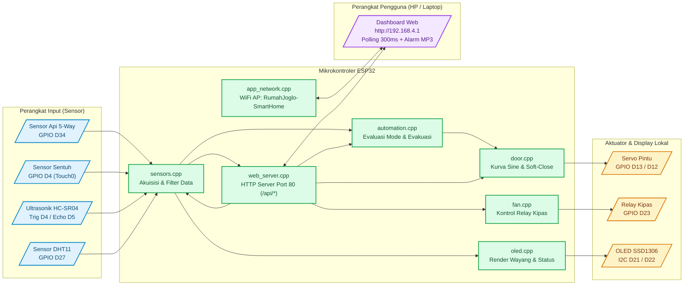
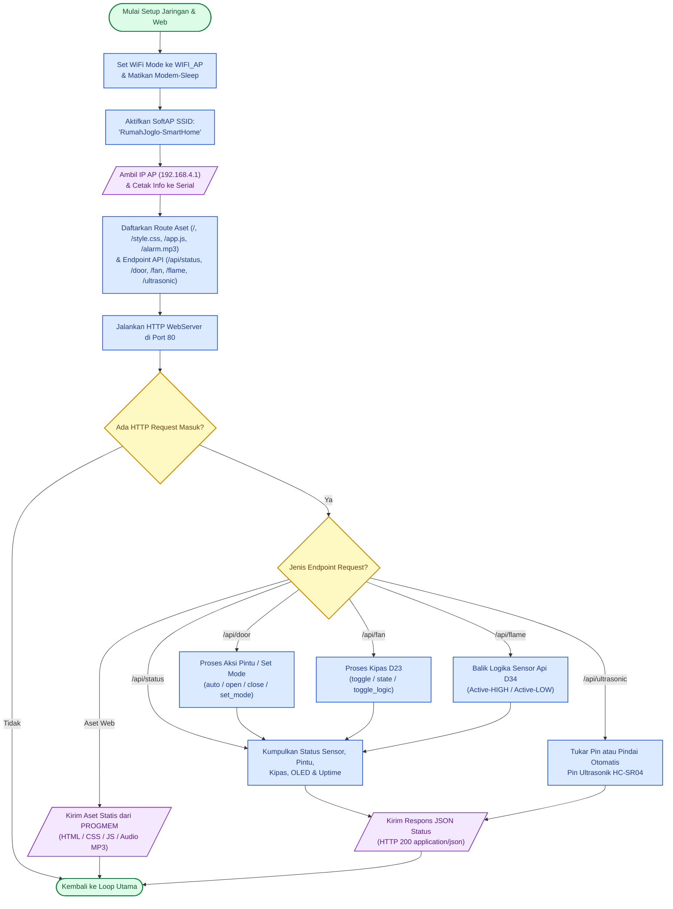
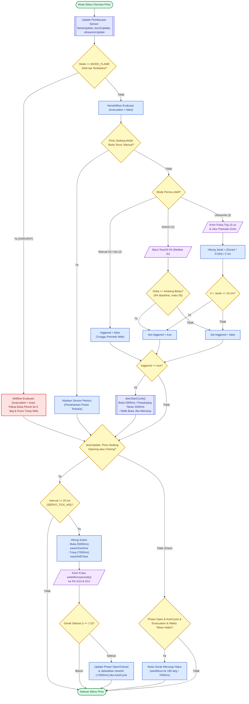
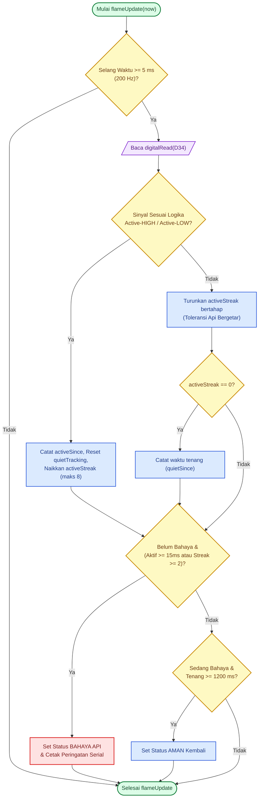
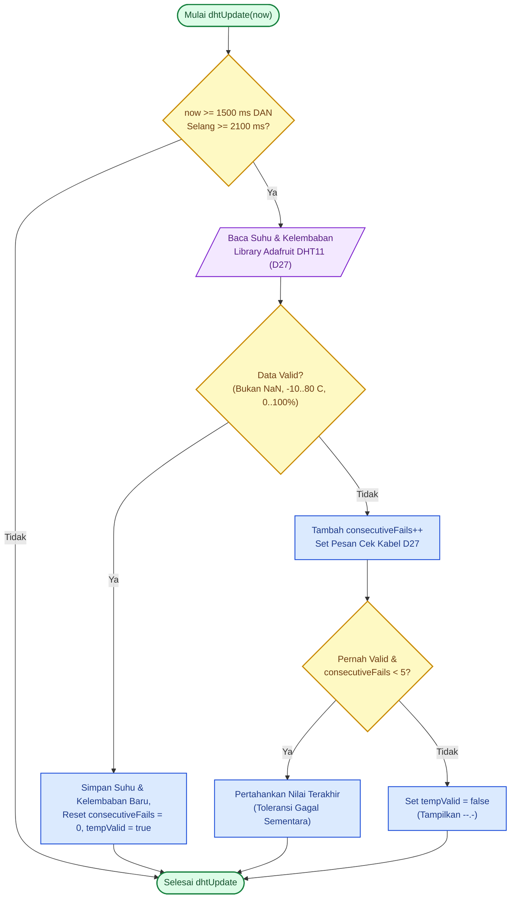
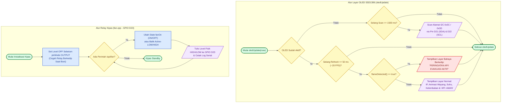

# 🏡 IoT Smart Home - Rumah Joglo
### Pintu Otomatis Servo (Gerak Halus), Sensor Api, Sensor Jarak, Sensor Sentuh, Sensor Suhu DHT11, Relay Kipas & Dashboard Web

[](https://platformio.org/)
[](https://www.espressif.com/)
[](https://www.arduino.cc/)
[](https://isocpp.org/)
[](LICENSE)

Smart home miniatur Rumah Joglo berbasis **ESP32**. Dashboard web disajikan langsung dari ESP32 melalui hotspot Access Point mandiri dan dapat diakses tanpa koneksi internet.

---

## ✨ Fitur

- **Pintu servo (D13, alternatif D12), gerak halus:** membuka dari 180° (tertutup) ke 0° (terbuka) dalam **5,0 detik** dengan kurva *ease-in-out sine* dan menutup kembali dalam **7,0 detik** dengan kurva *soft-close*. Pergerakan bersifat *non-blocking* (update tiap 20 ms) sehingga web server tetap responsif.
- **Tiga perintah pintu:** Buka 2 Detik (*auto-cycle*), Buka Terus (*manual open*), dan Tutup Rapat.
- **Pemicu otomatis (pilih satu mode):**
  - **Ultrasonik (HC-SR04 — default):** objek berjarak `1–10 cm` membuka pintu. Selama objek bertahan, waktu tahan 2 detik diperpanjang; jika objek muncul saat pintu sedang menutup, pintu langsung berbalik membuka.
  - **Sentuh (D4 / Touch0):** sentuh ujung kabel jumper di D4 (dengan *baseline* adaptif & filter median 3 sampel).
  - **Sensor Api (D34):** jika aktif, pintu langsung dibuka penuh ke 0° dan ditahan terbuka selama api terdeteksi (mode evakuasi). Tombol Tutup di web dikunci hingga api padam.
  - **Manual:** hanya dikendalikan lewat tombol dashboard web.
- **Detektor Api Anti-Flicker & Alarm Web:** status Aman/Bahaya dengan konfirmasi cepat (`15 ms` / *streak* ≥ 2), penahan rilis (`1200 ms`), opsi balik logika Active-HIGH/LOW, serta pemutaran audio alarm `/alarm.mp3` di browser.
- **Sensor Suhu & Kelembaban (DHT11 — D27):** pembacaan berkala setiap `2100 ms` (ditunda saat servo sedang bergerak agar gerak pintu tidak tersendat), dengan toleransi gagal baca hingga 5 kali berturut-turut.
- **Kendali Relay Kipas (D23):** kontrol ON/OFF langsung dari dashboard web beserta opsi pembalikan logika Active-LOW/HIGH.
- **OLED SSD1306 (I2C D21/D22 — opsional):** deteksi *hot-plug* otomatis (`0x3C` / `0x3D`), menampilkan IP, animasi sepasang wayang, suhu, kelembaban, status aman, serta layar peringatan berkedip saat bahaya api.
- **WiFi Access Point Mandiri:** ESP32 memancarkan hotspot `RumahJoglo-SmartHome` dengan IP `192.168.4.1` secara instan tanpa bergantung pada router eksternal.

---

## 🛠️ Komponen & Wiring

| Komponen | Pin Modul | Pin ESP32 |
| :--- | :--- | :--- |
| Servo SG90 / MG90S | Sinyal (oranye) | **D13** (alternatif paralel: **D12**) |
| | VCC / GND | 5V (VIN) / GND |
| Flame sensor 5-way (LM393) | DO | **D34** |
| | VCC / GND | 3V3 / GND |
| Sensor sentuh | Ujung kabel jumper | **D4** (Touch0) |
| HC-SR04 | Trig / Echo | **D4 / D5** (bisa ditukar atau dipindai dari web) |
| | VCC / GND | 5V / GND |
| Sensor DHT11 | Data | **D27** |
| | VCC / GND | 3V3 / GND |
| Relay Kipas 1-Channel | IN | **D23** (default Active-LOW) |
| | VCC / GND | 5V / GND |
| OLED SSD1306 128x64 (opsional) | SDA / SCL | **D21 / D22** |

> **Catatan Pin D4:** Sensor sentuh dan `Trig` HC-SR04 sama-sama memakai **D4** secara default. Firmware hanya membaca sentuh pada Mode Sentuh dan ultrasonik pada Mode Ultrasonik, namun jika dipasang bersamaan fisiknya dapat saling mengganggu. Pindahkan pin HC-SR04 melalui fitur **Pindai** di tab Pengaturan dashboard.

> **Catatan Daya Flame Sensor:** Beri daya **3V3** pada modul flame sensor karena pin **D34** ESP32 hanya mendukung level logika 3,3 V.

---

## 📊 Diagram & Flowchart Sistem

Seluruh diagram di bawah ini disusun menggunakan bentuk simbol standar flowchart (**ANSI/ISO**) agar sesuai dengan kebutuhan dokumentasi teknis, laporan, maupun presentasi:

| Simbol | Bentuk di Diagram | Fungsi |
| :--- | :--- | :--- |
| **Terminator** | Kapsul / Oval `([...])` | Titik mulai (*Start*) dan selesai (*End*) suatu alur |
| **Proses** | Persegi Panjang `[...]` | Inisialisasi, kalkulasi, perubahan state, dan kendali aktuator |
| **Keputusan (*Decision*)** | Belah Ketupat `{...}` | Percabangan logika kondisi (`Ya` / `Tidak` atau pilihan mode) |
| **Input / Output (I/O)** | Jajaran Genjang `[/.../]` | Pembacaan data sensor, pengiriman HTTP/JSON, tampilan OLED & Serial |
| **Subroutine** | Persegi Panjang Garis Ganda `[[...]]` | Pemanggilan fungsi/modul terpisah (seperti `automationUpdate`, `doorUpdate`) |

---

### 1. Arsitektur Sistem & Aliran Data

Diagram blok berikut menggambarkan hubungan antara perangkat input (sensor), modul pemrosesan di ESP32, aktuator/layar lokal, dan dashboard web pada perangkat pengguna.



---

### 2. Flowchart Alur Sistem Utama (`setup()` dan `loop()`)

Menggambarkan siklus hidup firmware pada [`src/main.cpp`](src/main.cpp) sejak ESP32 dinyalakan hingga berjalan terus-menerus di dalam `loop()`.

```mermaid
flowchart TD
    classDef term fill:#dcfce7,stroke:#15803d,stroke-width:2px,color:#14532d
    classDef proc fill:#dbeafe,stroke:#1d4ed8,stroke-width:1.5px,color:#1e3a8a
    classDef dec fill:#fef9c3,stroke:#ca8a04,stroke-width:2px,color:#713f12
    classDef io fill:#f3e8ff,stroke:#7e22ce,stroke-width:1.5px,color:#581c87
    classDef sub fill:#e0e7ff,stroke:#4338ca,stroke-width:1.5px,color:#312e81

    START(["Mulai (ESP32 Power ON)"]):::term
    SER_INIT["Inisialisasi Serial Monitor (115200 bps)"]:::proc
    RST_CHK[/"Baca Alasan Reset (esp_reset_reason)"/]:::io
    HW_BEGIN["Inisialisasi Awal Aktuator & Sensor:\n- doorBegin() (Servo D13/D12 ke 180 deg)\n- fanBegin() (Relay D23 OFF)\n- ultrasonicBegin(), flameBegin(), dhtBegin()"]:::proc
    OLED_BOOT[["oledBegin() & oledShowBoot('Memulai Sistem...')"]]:::sub
    NET_WEB[["networkBegin() & webBegin()\n(Aktifkan Hotspot AP + Server Port 80)"]]:::sub
    OLED_SPLASH[/"Tampilkan Splash Screen 'ONLINE' & IP di OLED"/]:::io
    CHK_TOUCH{"triggerMode() == MODE_TOUCH?"}:::dec
    TOUCH_CAL[["touchBegin()\nKalibrasi Baseline D4"]]:::sub
    SER_INFO[/"Cetak Konfigurasi Pin & IP Dashboard ke Serial"/]:::io

    LOOP_NET["networkMaintain(now)"]:::proc
    LOOP_WEB[["webHandle()\nLayani Permintaan HTTP Klien"]]:::sub
    CHK_PHASE{"Pintu Sedang Diam?\n(Phase Closed atau Open)"}:::dec
    LOOP_DHT[["dhtUpdate(now)\nBaca Suhu & Kelembaban D27"]]:::sub
    LOOP_AUTO[["automationUpdate(now)\nBaca Sensor & Evaluasi Pemicu"]]:::sub
    LOOP_DOOR[["doorUpdate(now)\nUpdate Pulsa Halus Servo"]]:::sub
    LOOP_OLED[["oledUpdate(now)\nRefresh Tampilan OLED"]]:::sub
    CHK_LOG{"Selisih Waktu >= 3000 ms?"}:::dec
    SER_LOG[/"Cetak Status Sistem ke Serial Monitor"/]:::io
    DELAY_LOOP["Jeda Singkat delay(1)"]:::proc

    START --> SER_INIT --> RST_CHK --> HW_BEGIN --> OLED_BOOT --> NET_WEB --> OLED_SPLASH --> CHK_TOUCH
    CHK_TOUCH -- "Ya" --> TOUCH_CAL --> SER_INFO
    CHK_TOUCH -- "Tidak" --> SER_INFO

    SER_INFO --> LOOP_NET
    LOOP_NET --> LOOP_WEB --> CHK_PHASE
    CHK_PHASE -- "Ya" --> LOOP_DHT --> LOOP_AUTO
    CHK_PHASE -- "Tidak (Servo Bergerak)" --> LOOP_AUTO
    LOOP_AUTO --> LOOP_DOOR --> LOOP_OLED --> CHK_LOG
    CHK_LOG -- "Ya" --> SER_LOG --> DELAY_LOOP
    CHK_LOG -- "Tidak" --> DELAY_LOOP
    DELAY_LOOP --> LOOP_NET
```



---

### 3. Flowchart Jaringan WiFi Access Point & Layanan Web Server

Menggambarkan cara ESP32 membangun hotspot mandiri pada [`src/app_network.cpp`](src/app_network.cpp) serta melayani endpoint API pada [`src/web_server.cpp`](src/web_server.cpp) untuk dashboard web ([`src/web/app_js.h`](src/web/app_js.h)).



---

### 4. Flowchart Logika Otomasi Pintu & Gerak Halus Servo

Menggambarkan inti pengendalian pintu pada [`src/automation.cpp`](src/automation.cpp) dan [`src/door.cpp`](src/door.cpp), termasuk prioritas **Evakuasi Api**, mode pemicu (**Sentuh / Ultrasonik / Manual**), pencegahan terjepit (*re-open*), serta kurva pergerakan halus *Ease-In-Out Sine* dan *Soft-Close*.



---

### 5. Flowchart Sensor Api Anti-Flicker & Sensor Suhu DHT11

#### 5A. Alur Deteksi Api 5-Way (`flameUpdate` pada [`src/sensors.cpp`](src/sensors.cpp))



#### 5B. Alur Sensor Suhu & Kelembaban (`dhtUpdate` pada [`src/sensors.cpp`](src/sensors.cpp))



---

### 6. Flowchart Layar OLED SSD1306 & Kendali Relay Kipas

Menggambarkan deteksi *hot-plug* I2C serta pergantian tampilan OLED ([`src/oled.cpp`](src/oled.cpp)) dan kendali aman relay kipas ([`src/fan.cpp`](src/fan.cpp)).



---

## 📁 Struktur Kode

```text
include/
  config.h            konfigurasi pin, sudut servo, durasi gerak, ambang sensor
src/
  main.cpp            setup() dan loop() utama
  door.*              servo pintu D13/D12, kurva gerak halus, siklus buka-tahan-tutup
  fan.*               kontrol relay kipas D23 (ON/OFF & Active-LOW/HIGH)
  sensors.*           sensor api D34, sentuh D4, ultrasonik HC-SR04, suhu DHT11 D27
  automation.*        evaluasi mode pemicu otomatis & prioritas evakuasi api
  oled.*              layar SSD1306 (deteksi hot-plug, animasi wayang, layar bahaya)
  app_network.*       Access Point mandiri (Hotspot RumahJoglo-SmartHome)
  web_server.*        route HTTP & API JSON
  web/index_html.h    HTML dashboard   (PROGMEM, route /)
  web/style_css.h     CSS dashboard    (PROGMEM, route /style.css)
  web/app_js.h        JS dashboard     (PROGMEM, route /app.js)
  web/alarm_mp3.h     Audio alarm api  (PROGMEM, route /alarm.mp3)
```

### API HTTP (semua GET, respons JSON status)

| Route | Parameter | Keterangan |
| :--- | :--- | :--- |
| `/api/status` | — | Status lengkap sensor, pintu, kipas, OLED, IP, dan *uptime* |
| `/api/door` | `action=auto\|open\|close`, atau `action=set_mode&mode=0..3` | Kendali pintu & pemilihan mode pemicu (0=Manual, 1=Sentuh, 2=Api, 3=Ultrasonik) |
| `/api/fan` | `toggle=1`, `state=on\|off\|1\|0`, atau `toggle_logic=1` | Kendali relay kipas D23 dan balik logika Active-LOW/HIGH |
| `/api/flame` | `toggle_logic=1` | Balik logika sensor api (Active-HIGH / Active-LOW) |
| `/api/ultrasonic` | `swap=1`, atau `scan=1` | Tukar pin Trig/Echo atau pindai pin otomatis (`{result, trigPin, echoPin}`) |

---

## 📱 Build & Upload

1. Hubungkan ESP32 ke komputer melalui kabel USB.
2. Upload firmware via PlatformIO:
   ```bash
   pio run --target upload
   pio device monitor
   ```
3. Sambungkan HP/Laptop ke WiFi **`RumahJoglo-SmartHome`** lalu buka **`http://192.168.4.1`** di browser.

---

## 📄 Lisensi

Proyek ini dirilis di bawah lisensi [MIT License](LICENSE). Bebas digunakan, dimodifikasi, dan dikembangkan untuk keperluan edukasi dan proyek IoT pribadi.
