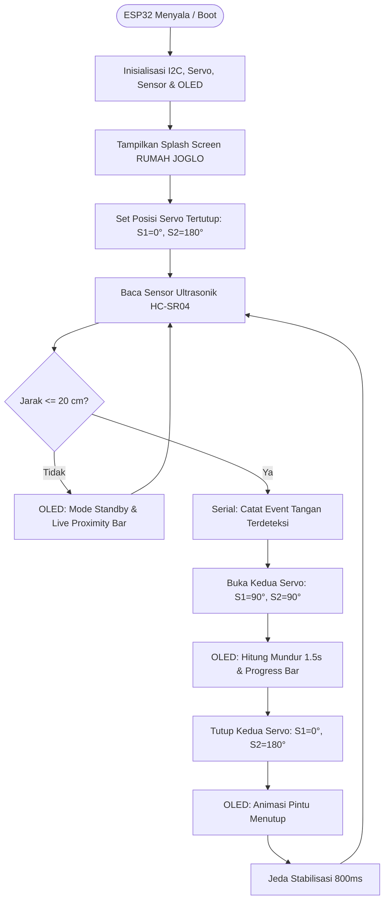

# 🏡 IoT Smart Home - Rumah Joglo
### Sistem Pintu Otomatis Dual Servo Kupu-Tarung dengan Sensor Ultrasonik & OLED GUI

[](https://platformio.org/)
[](https://www.espressif.com/)
[](https://www.arduino.cc/)
[](https://isocpp.org/)
[](LICENSE)

Proyek sistem **Smart Home miniatur Rumah Joglo** berbasis mikrokontroler **ESP32**. Sistem ini mengotomatiskan pembukaan dan penutupan dua daun pintu (model kupu-tarung) menggunakan sepasang motor servo yang bergerak simetris berlawanan arah. Deteksi dilakukan secara *touchless* menggunakan sensor ultrasonik HC-SR04, dan status pintu serta pembacaan sensor ditampilkan secara *real-time* melalui antarmuka grafis (GUI) modern pada layar OLED SSD1306 (I2C).

---

## ✨ Fitur Utama

- ✋ **Deteksi Non-Kontak (*Touchless*):** Menggunakan sensor ultrasonik HC-SR04 untuk mendeteksi telapak tangan atau tamu pada jarak $\le$ 20 cm.
- 🚪 **Dual Servo Kupu-Tarung Simetris:** Dua servo bergerak membuka dan menutup secara berlawanan arah (*mirrored motion*) layaknya daun pintu ganda Rumah Joglo:
  - **Pintu 1 (Pin D13):** Tertutup `0°` $\rightarrow$ Terbuka `90°`
  - **Pintu 2 (Pin D12):** Tertutup `180°` $\rightarrow$ Terbuka `90°`
- ⏱️ **Otomasi Buka-Tutup Cerdas:** Pintu terbuka selama **1,5 detik**, kemudian menutup kembali secara otomatis dan rapat.
- 📟 **OLED GUI Modern & Interaktif (SSD1306):**
  - *Splash screen* animasi saat pertama kali dinyalakan.
  - Tampilan standby elegan lengkap dengan *badge* status `[ PINTU TERTUTUP ]`.
  - **Proximity Gauge Bar:** Bar visual yang terisi semakin penuh saat tangan mendekati sensor.
  - **Live Countdown Progress Bar:** Bar penghitung mundur menyusut halus secara *real-time* selama 1,5 detik sebelum pintu menutup kembali.
  - Animasi visual arah pintu membuka dan menutup (`<[BUKA] [BUKA]>` & `[ ==>> <<== ]`).
- ⚡ **I2C Fast Mode (400 kHz):** Menjamin pembaruan grafis layar sangat responsif dan bebas kedip (*zero flicker*).
- 🧹 **Serial Monitor Bersih (*Event-Driven*):** Tidak ada *spamming* pembacaan jarak; terminal hanya mencetak peristiwa penting (*clean logging*).

---

## 🛠️ Komponen & Hardware

| No | Komponen | Tipe / Spesifikasi | Keterangan |
| :---: | :--- | :--- | :--- |
| 1 | **Mikrokontroler** | ESP32 DOIT DevKit V1 (30 / 38 Pin) | Otak pemroses utama |
| 2 | **Sensor Jarak** | HC-SR04 Ultrasonic Sensor | Deteksi jarak tangan / tamu |
| 3 | **Aktuator Pintu** | 2x Micro Servo SG90 (atau MG90S) | Penggerak daun pintu kiri & kanan |
| 4 | **Display / Layar** | OLED 0.96 inch SSD1306 I2C (128x64) | Tampilan GUI & informasi sistem |
| 5 | **Sumber Daya** | 5V DC (Kabel USB / Adaptor External) | Disarankan suplai terpisah untuk servo |
| 6 | **Kabel & Board** | Shield ESP32 / Breadboard & Jumper | Jalur koneksi antar modul |

---

## 🔌 Skema Pin & Wiring Diagram

### 1. Sensor Ultrasonik HC-SR04
| Pin HC-SR04 | Pin ESP32 | Keterangan |
| :--- | :--- | :--- |
| **VCC** | **5V / VIN** | Daya 5 Volt |
| **GND** | **GND** | Ground |
| **TRIG** | **GPIO 5 (D5)** | Trigger pulsa ultrasonik |
| **ECHO** | **GPIO 18 (D18)** | Echo pantulan gelombang |

### 2. Dual Motor Servo (SG90)
| Pin Servo | Warna Kabel | Pin ESP32 | Keterangan |
| :--- | :--- | :--- | :--- |
| **Servo 1 (Signal)** | Oranye / Kuning | **GPIO 13 (D13)** | Kontrol PWM Pintu 1 |
| **Servo 2 (Signal)** | Oranye / Kuning | **GPIO 12 (D12)** | Kontrol PWM Pintu 2 |
| **VCC (Keduanya)** | Merah | **5V / VIN** | Daya motor servo |
| **GND (Keduanya)** | Cokelat / Hitam | **GND** | Ground bersama (*common ground*) |

### 3. Layar OLED SSD1306 I2C (128x64)
| Pin OLED | Warna Panduan | Pin ESP32 | Keterangan |
| :--- | :--- | :--- | :--- |
| **GND** | Biru | **GND** | Ground |
| **VCC** | Kuning | **3V3** | Tegangan logika 3.3V (aman) |
| **SCL** | Kuning (kedua) | **GPIO 22 (D22)** | Jalur I2C Clock |
| **SDA** | Ungu | **GPIO 21 (D21)** | Jalur I2C Data |

---

## ⚙️ Diagram Alur Kerja Sistem



---

## 📁 Struktur Direktori

```text
Smarthome-Rumahjoglo/
├── .pio/                  # Cache & build environment PlatformIO
├── include/               # Header kustom tambahan (opsional)
├── lib/                   # Pustaka lokal (opsional)
├── src/
│   └── main.cpp           # Kode sumber utama logika sistem, servo & GUI OLED
├── test/                  # Unit testing
├── platformio.ini         # Konfigurasi board, dependensi library & upload speed
└── README.md              # Dokumentasi proyek
```

---

## 🚀 Panduan Memulai (Instalasi & Penggunaan)

### Prasyarat:
1. Pasang [Visual Studio Code](https://code.visualstudio.com/).
2. Pasang ekstensi **PlatformIO IDE** dari VS Code Marketplace.
3. Hubungkan board ESP32 ke komputer melalui kabel USB Data.

### Langkah-langkah:
1. **Clone repositori ini:**
   ```bash
   git clone https://github.com/Juremenn/IoT-Smarthome.git
   ```
2. Buka folder proyek di **VS Code / PlatformIO**.
3. Dependensi library akan terunduh otomatis berdasarkan file `platformio.ini`:
   - `madhephaestus/ESP32Servo`
   - `adafruit/Adafruit SSD1306`
   - `adafruit/Adafruit GFX Library`
4. **Kompilasi (Build):**
   Tekan tombol centang (`✓`) di status bar bawah VS Code atau jalankan terminal:
   ```bash
   pio run
   ```
5. **Unggah Program (Upload):**
   Tekan tombol panah kanan (`→`) di status bar bawah VS Code:
   ```bash
   pio run --target upload
   ```
6. **Buka Serial Monitor:**
   Tekan ikon colokan (`🔌`) pada baudrate **115200**:
   ```bash
   pio device monitor -b 115200
   ```

---

## 🔧 Kustomisasi Parameter

Kamu dapat menyesuaikan parameter fisik di baris awal file [`src/main.cpp`](src/main.cpp):

```cpp
// Batas jarak deteksi tangan (satuan cm)
const int MAX_DISTANCE = 20;

// Sudut pergerakan servo (atur jika daun pintu perlu sudut berbeda)
const int SERVO1_CLOSE = 0;    // Pintu 1 tertutup
const int SERVO1_OPEN  = 90;   // Pintu 1 terbuka

const int SERVO2_CLOSE = 180;  // Pintu 2 tertutup (berlawanan arah)
const int SERVO2_OPEN  = 90;   // Pintu 2 terbuka

// Durasi pintu terbuka (dalam milidetik, 1500 ms = 1.5 detik)
const int DURASI_BUKA_MS = 1500;
```

---

## 👨‍💻 Kontributor

- **Juremenn** - Inisiator, Pengembang & Pemilik Proyek ([@Juremenn](https://github.com/Juremenn))

---

## 📄 Lisensi

Proyek ini dirilis di bawah lisensi [MIT License](LICENSE). Bebas digunakan, dimodifikasi, dan dikembangkan untuk keperluan edukasi dan proyek IoT pribadi.
